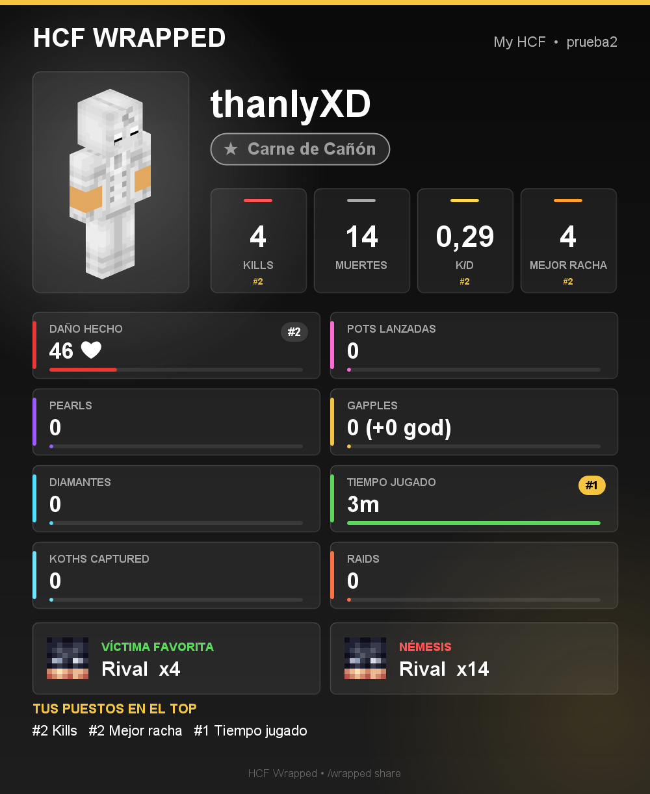
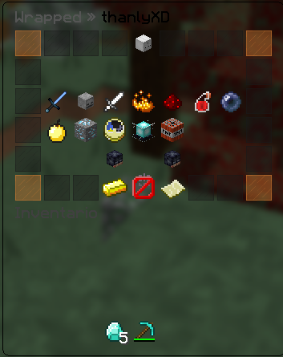
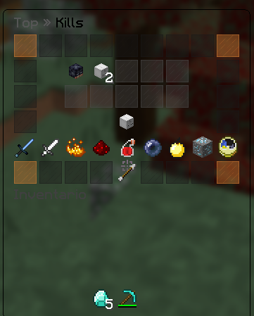
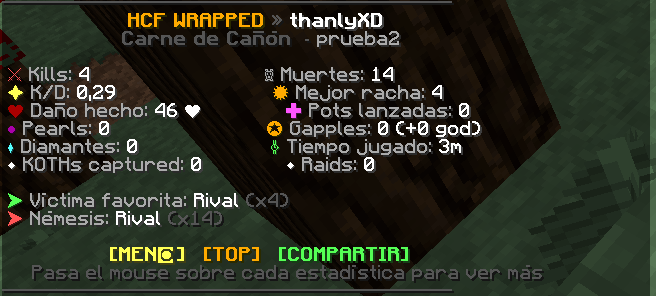

# HCF Wrapped

A **"Spotify Wrapped" for HCF maps**. During the map it silently tracks what every player does. When the map ends, each player gets their **season recap** in a menu and in chat, plus a **stats card image** they can share on Discord.

Made for **Spigot / Paper 1.8.8** (Java 8). Tested with Lunar Client 1.8.9.



## ⚠️ Important: sharing cards needs a Discord webhook
`/wrapped share` draws the player's card and **posts it to your Discord channel through a webhook**. That is how players get their image.

- **With a webhook** → the card appears in your Discord channel ("**Player** shared their HCF Wrapped!") and players can download and share it.
- **Without a webhook** → the image is only saved on the server, in `plugins/HCFWrapped/cards/<player>.png`. **Players can't see it** (only the server owner can).

How to set it up (1 minute):
1. In Discord: **Channel settings → Integrations → Webhooks → New Webhook → Copy Webhook URL**.
2. Paste it in `plugins/HCFWrapped/config.yml`:
   ```yaml
   discord:
     webhook-url: "https://discord.com/api/webhooks/..."
   ```
3. `/wrapped reload`

Everything else (menu, chat recap, top lists, titles) works without Discord.

## Screenshots
| Menu (`/wrapped`) | Top (`/wrapped top`) | Chat (`/wrapped chat`) |
|---|---|---|
|  |  |  |

## What it tracks
- Kills, deaths, K/D and **best kill streak**
- **Favorite victim** (who you killed the most) and **nemesis** (who killed you the most)
- Damage dealt and taken
- **Pots thrown**, **ender pearls**, **golden apples** and **god apples**
- **Diamonds mined** and **playtime**
- **Any HCF stat from your core** (KOTH captures, raids...) with `/wrapped add`, so it works with any HCF core or KOTH plugin

## Features
- **Chest menu**: your head with your title, every stat as an item (hover = your value, your rank, the server average and a progress bar), your favorite victim and nemesis heads, and buttons to see the top or share your card. Stats where you are top 3 glow.
- **Top menu**: the 10 best heads of any stat, your own rank, and a row to switch stats. Click a head to see that player's Wrapped.
- **Chat recap** (`/wrapped chat`): centered, two columns, hover on each stat for details, clickable [MENU] [TOP] [SHARE] buttons.
- A fun **title** based on what the player did most compared to the server average (Pot Addict, Pearl Master, The Immortal, Cannon Fodder...).
- **Image card** (`/wrapped share`): full body skin, big numbers, a color and a progress bar for every stat, top places and the faces of your victim and nemesis. Posted to Discord via webhook (see above).
- `/wrapped season end` announces the end of the map and posts the **server recap** (top 3 of every category) on Discord.
- Seasons are saved separately in `plugins/HCFWrapped/seasons/`.
- English and Spanish included, every message editable (UTF-8).
- Only watches events (MONITOR priority): it never changes gameplay and respects cancelled events from your core.

## Commands
| Command | Permission | Description |
|---|---|---|
| `/wrapped [player]` | `hcfwrapped.use` / `hcfwrapped.others` | Open the Wrapped menu |
| `/wrapped chat [player]` | `hcfwrapped.use` / `hcfwrapped.others` | Show the recap in chat |
| `/wrapped top [stat]` | `hcfwrapped.use` | Top menu (or top 10 in chat with a stat) |
| `/wrapped share` | `hcfwrapped.use` | Create your card and post it on Discord |
| `/wrapped season start <name>` | `hcfwrapped.admin` | Start tracking a new map |
| `/wrapped season end` | `hcfwrapped.admin` | End the map and unlock the Wrapped |
| `/wrapped add <player> <stat> <amount>` | `hcfwrapped.admin` | Add custom HCF stats (KOTH, raids...) |
| `/wrapped recap` | `hcfwrapped.admin` | Server top 3 in chat and Discord |
| `/wrapped reload` | `hcfwrapped.admin` | Reload config and language |

By default players can only see their Wrapped **after** `/wrapped season end` (`view-during-season: false`), like the real Wrapped. Set `open-menu: false` if you prefer `/wrapped` to print the chat version.

## config.yml options
| Option | Default | What it does |
|---|---|---|
| `language` | `en` | Language file from `plugins/HCFWrapped/lang/` (`en`, `es`, or add your own) |
| `server-name` | `My HCF` | Shown on the image card |
| `view-during-season` | `false` | Let normal players see their Wrapped while the map is still running |
| `open-menu` | `true` | `/wrapped` opens the chest menu; `false` prints the chat version instead |
| `remind-on-join` | `true` | After the season ends, remind players to check their Wrapped when they join |
| `share-cooldown-seconds` | `300` | Seconds between `/wrapped share` for the same player |
| `custom-stats` | `koth`, `raids` | Extra HCF stats (`id: "Name shown"`), filled with `/wrapped add` |
| `discord.webhook-url` | empty | **Needed to share cards** (see the top of this page) |
| `discord.recap-on-end` | `true` | Post the server top 3 on Discord when you run `/wrapped season end` |
| `card.accent-color` | `#F5C542` | Main color of the card |
| `card.background-top` / `card.background-bottom` | `#0A0A0A` / `#1E1E1E` | Card background gradient |
| `card.avatar-url` | mc-heads avatar | Where to get faces. `{player}` = player name |
| `card.body-url` | mc-heads body | Full body render on the card (falls back to the face) |

All messages, stat names and titles are in `lang/en.yml` and `lang/es.yml` (UTF-8, `&` color codes). After editing: `/wrapped reload`.

## Custom HCF stats
In `config.yml`:
```yaml
custom-stats:
  koth: "KOTHs captured"
  raids: "Raids"
```
Then make your KOTH / core plugin run this console command as a reward:
```
wrapped add %player% koth 1
```

## Building
The 1.8.8 API is taken from the Paper 1.8.8 server itself: run the server once, then copy `cache/patched_1.8.8.jar` into this project's `libs/` folder and run:
```
./gradlew build
```
The jar is created in `build/libs/`.

## License
MIT
